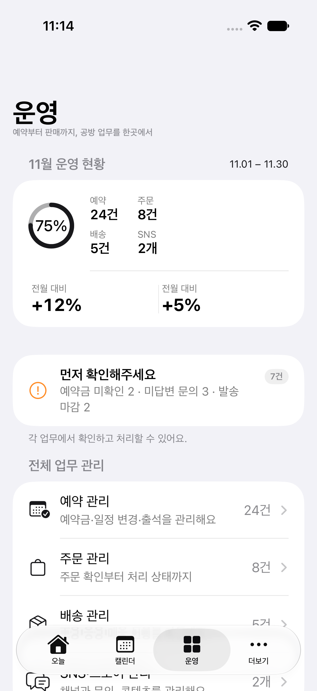
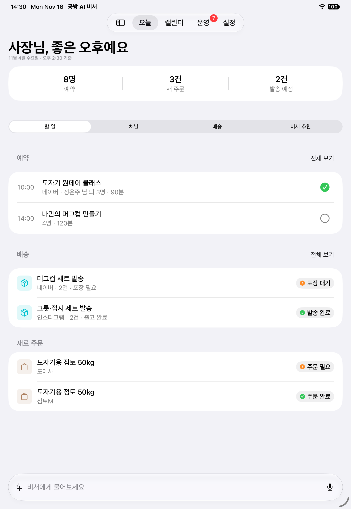

# 공방 AI 비서 iOS 앱

공방 사장님이 예약, 주문, 배송, 문의를 한곳에서 처리하는 SwiftUI 앱입니다. 홈 화면에 보이는 앱 이름은 공도리입니다. 화면 배치는 [Figma 파일](https://www.figma.com/design/nUn7ayeiKAVljMiPvwQQV3/Untitled)을 기준으로 짰습니다. iOS 앱은 Swift Package나 CocoaPods 같은 외부 의존성을 쓰지 않고 저장소 안의 `RoundupCore` 패키지만 씁니다.

화면의 업무 데이터는 `Server/`의 FastAPI 서버가 PostgreSQL에서 읽어 줍니다. 건수와 배지도 서버가 DB 행으로 계산합니다. 입금 확인, 포장, 답변 완료 같은 동작은 DB에 저장되므로 앱을 다시 켜도 유지됩니다. 답변을 완료해도 손님께 메시지가 가지는 않습니다.

앱을 실행하기 전에 [서버 연결 설정](#서버-연결-설정)을 먼저 해 주세요. 서버 배포 방법은 [운영 서버](#운영-서버)에 있습니다.

Xcode 없이 화면 시안만 보려면 [웹 버전으로 보기](#웹-버전으로-보기)로 넘어가면 됩니다. 웹 버전은 서버에 연결되지 않습니다.

## 스크린샷

| 오늘 | 캘린더 (주간) | 운영 | 예약 관리 |
|---|---|---|---|
|  |  |  |  |

| iPad | 다크 모드 |
|---|---|
|  |  |

## 목차

- [팀원 안내](#팀원-안내)
- [화면 구성](#화면-구성)
- [웹 버전으로 보기](#웹-버전으로-보기)
- [준비물](#준비물)
- [서버 연결 설정](#서버-연결-설정)
- [시뮬레이터에서 실행하기](#시뮬레이터에서-실행하기)
- [시뮬레이터 사용 팁](#시뮬레이터-사용-팁)
- [실제 iPhone에 설치하기 (무료 계정)](#실제-iphone에-설치하기-무료-계정)
- [테스트 실행하기](#테스트-실행하기)
- [명령줄로 빌드·테스트하기](#명령줄로-빌드테스트하기)
- [운영 서버](#운영-서버)
- [문제 해결](#문제-해결)
- [프로젝트 구조](#프로젝트-구조)
- [Figma 화면과 코드 대응표](#figma-화면과-코드-대응표)
- [사용한 iOS 기본 구성 요소](#사용한-ios-기본-구성-요소)
- [아직 넣지 않은 것](#아직-넣지-않은-것)

## 팀원 안내

이 저장소는 공개되어 있어 누구나 코드를 볼 수 있습니다. 운영 서버에 접속하는 앱 키는 저장소에 넣지 않으며 팀원에게 따로 전합니다.

1. 코드를 push할 팀원은 GitHub 초대를 수락합니다. 초대는 <https://github.com/stevenahhh/gb-ios/invitations>에서 확인합니다. 초대는 7일 뒤 만료되므로 그 전에 수락해 주세요.
2. Mac에서 GitHub에 로그인합니다. [GitHub CLI](https://cli.github.com)를 쓴다면 `gh auth login`을 실행합니다.
3. [서버 연결 설정](#서버-연결-설정)대로 설정 파일에 앱 키를 넣고 Xcode에서 실행합니다.

```bash
git clone https://github.com/stevenahhh/gb-ios.git
cd gb-ios
cp Config/RoundupSecrets.example.plist GongbangAssistant/RoundupSecrets.plist
open GongbangAssistant/RoundupSecrets.plist
open GongbangAssistant.xcodeproj
```

| 할 수 있는 일 | 필요한 것 |
|---|---|
| 앱 실행 | Mac, Xcode |
| 코드 push | 저장소 쓰기 권한 |
| 서버 배포 | 운영 Mac의 SSH 키, ACG에 등록된 IP |

본인 iPhone에 설치하려면 [실제 iPhone에 설치하기](#실제-iphone에-설치하기-무료-계정)를 봐 주세요. 돈은 들지 않습니다.

## 화면 구성

앱 아래쪽 탭은 네 개입니다.

| 탭 | SF Symbol | 내용 |
|---|---|---|
| 오늘 | house | 시간대에 맞춘 인사 제목, 날짜와 마지막 업데이트 시각 부제, 숫자 3개, 할 일 / 채널 / 배송 / 비서 추천 세그먼트, 그룹 목록 |
| 캘린더 | calendar | 주간 보기가 기본이고 한 번 누르면 월간 보기, 선택한 날의 일정 |
| 운영 | square.grid.2x2 | 처리할 일 배지, "먼저 확인해주세요", 이번 달 운영 현황, 전체 업무 관리, 공방 성장 |
| 설정 | gearshape | 공방 정보, 예약·환불 규정, 고객 안내 문구, 채널 연결, 도움말 |

### 오늘

큰 제목은 지금 가장 먼저 할 일을 한 줄로 알려 줍니다. 기한 지난 일("못 보낸 택배 2건"), 2시간 안에 시작하거나 진행 중인 수업("30분 뒤 머그컵 수업"), 처리 대기("답변 기다리는 문의 3건"), 오늘 남은 일정, 다 끝난 날, 내일·이번 주 수업 순서로 처음 맞는 하나를 쓰고, 1분마다와 데이터가 바뀔 때 다시 계산합니다. 규칙은 RoundupCore의 `TodayHeadline`에 있습니다. 화면을 아래로 당기면 새로 고침이 일어납니다. 예약 행의 체크 버튼을 누르거나 행을 오른쪽으로 밀면 수업 완료로 저장되고, 제목에 취소선이 그어진 채 목록에 남습니다. 행을 누르면 어느 탭에서나 같은 예약 상세가 열립니다.

### 처음 안내

앱을 처음 열면 여섯 단계 안내가 나옵니다. 공방 정보, 쓰는 서비스, 비서에게 필요한 자료, 요금제를 차례로 묻고 마지막에 화면을 둘러보는 튜토리얼을 시작합니다. 단계마다 "나중에 하기"로 넘길 수 있고 앱을 껐다 켜면 보던 단계에서 이어집니다. 설정의 "처음 안내 다시 보기"로 다시 엽니다.

- 서비스 연결은 공개 계정 이름이나 주소를 저장하는 화면입니다. 로그인하지 않고 비밀번호도 묻지 않습니다. 저장한 값은 "저장됨"으로 보이며 실제로 수집하기 전에는 연결됐다고 표시하지 않습니다.
- 요금제는 월 14,900원 하나와 "요금제 없이"입니다. 결제 기능이 없어서 고른 값만 기기에 저장하고 화면에 "아직 결제되지 않아요"라고 적습니다.
- 튜토리얼은 실제 화면 위에서 확인해 주실 일, 취소·노쇼, 운영의 남은 일, 일정 추가, 비서 막대, 다시 보기 위치를 하나씩 짚습니다. 화면에 없는 항목은 건너뜁니다.

### 비서 막대

"채팅하기" 막대는 모든 탭에서 탭 바 위에 붙어 있습니다. 막대를 누르면 비서 시트가 올라옵니다. 시트가 열리면 커서가 바로 입력창에 놓이고 추천 질문 세 개가 보입니다. 입력창 아래에는 "비서가 틀릴 수 있어요"라는 문구를 넣었습니다. 시트 안 마이크 버튼은 말을 녹음해 서버의 음성 인식으로 글자로 바꿉니다. 질문을 보내면 서버가 DB 현황을 근거로 답합니다. 일을 맡기는 말은 [비서가 스스로 하는 일](#비서가-스스로-하는-일)의 규칙대로 처리합니다. 앞선 대화 6개를 함께 보내므로 "그중 내일 것만"처럼 이어서 물어도 됩니다. 비서와 나눈 대화는 기기에 저장되어 시트를 닫거나 앱을 다시 켜도 남습니다. 최근 100개까지 보관합니다. 시트 오른쪽 위 시계 버튼(지난 대화)을 누르면 날짜별 목록이 나오고, 대화를 열어 이어서 물을 수 있습니다. 연필 버튼(새 대화)은 빈 대화를 시작합니다. 30분 안에 시트를 다시 열면 하던 대화가 그대로 이어집니다. 공도리 로고는 오늘 탭 왼쪽 위에만 표시하고 답변이나 초안 옆에는 반복하지 않습니다.

막대 오른쪽 마이크를 누르면 전체 화면 실시간 음성 대화가 열립니다. 말하는 동안 글자가 자막으로 뜨고, 잠시 멈추면 비서가 소리 내어 답하며 자막을 한 단어씩 밝힙니다. 가운데 구를 누르면 답을 끊고 다시 듣습니다. 아래 버튼은 대화 내용, 마이크, 끝내기 세 개입니다. 최종 문장은 네이버 CLOVA 음성 인식(`/stt`)으로 확정합니다. 답은 서버의 `POST /tts`를 거쳐 네이버 CLOVA Voice Premium의 유나 Pro 목소리로 읽습니다. 문장 단위로 읽고 다음 문장은 미리 받아 둡니다. `/tts`가 실패하면 10분 동안 iPhone에 설치된 가장 좋은 한국어 목소리가 대신 읽습니다. CLOVA Voice Premium은 호출이 없어도 기본료 월 90,000원이 나가는 상품입니다. 더 쓰지 않을 때는 NCP 콘솔의 `gongbang-speech` 앱에서 서비스를 빼고 `LiveSpeechConfig.usesServerSpeech`를 끕니다.

### 비서가 스스로 하는 일

비서는 사장님이 방금 한 말에서 근거를 찾으면 바로 처리합니다. 근거가 모자라면 제안 카드를 올려 승인을 기다립니다. 모델은 쓸 도구를 고르기만 하고 처리 여부는 서버의 정해진 규칙(`agent_policy.py`)이 결정합니다. 손님 문의, 메모, 지난 대화에 적힌 말은 근거로 치지 않습니다.

| 일 | 비서가 처리하는 방식 |
|---|---|
| 예약, 주문, 배송, 문의, 일정 찾아보기 | 읽기만 합니다 |
| 답장과 홍보 글 초안 쓰기, 할 일 완료하고 다시 열기 | 대상이 하나로 정해지면 바로 합니다 |
| 일정 넣고 옮기기 | 날짜와 시각까지 사장님의 말에 있으면 바로 하고 없으면 제안으로 올립니다 |
| 기억하기, 잊기 | 사장님이 지금 말한 내용이 있을 때 합니다 |
| 주문 확인, 포장 완료, 송장 등록, 배송 완료, 예약금 확인, 예약 만들기, 취소 결정 기록, 출강 견적 결과 기록 | 대상과 값이 사장님의 말에 있으면 바로 하고 없으면 제안으로 올립니다 |

"1040 포장 끝났어"라고 하면 1040번 주문을 포장 완료로 바꿉니다. "포장할 거 있어?"는 질문이라 근거가 되지 않습니다. 맞는 대상이 여럿이거나 없으면 어느 건인지 되묻습니다. 송장번호는 사장님이 준 번호를 그대로 등록합니다. 택배사 연동이 없어서 번호가 실제로 맞는지는 확인하지 못합니다.

아래 일은 도구로 만들지 않았습니다. 어떤 설정으로도 비서에게 맡길 수 없습니다.

- 손님에게 메시지를 보내거나 공유하는 일
- 결제와 환불
- 기록 삭제
- 가격, 규칙, 설정 변경
- 손님 답변을 완료로 처리하는 일
- 답장의 숫자 잠금을 푸는 일

#### 맡기는 방식

설정의 "비서에게 맡길 일"에서 고릅니다. 처음 값은 "끔"이라 사장님이 방식을 고른 뒤부터 비서가 일합니다.

| 방식 | 동작 |
|---|---|
| 끔 | 스스로 하는 일도 올리는 제안도 없습니다. 물어보면 답은 합니다 |
| 물어보고 | 바꾸는 일을 모두 제안으로 올립니다 |
| 알아서 | 근거가 있는 일은 바로 하고 나머지는 제안으로 올립니다 |

일마다 방식을 따로 정해도 됩니다. 전체를 끄면 일별 설정보다 먼저 적용합니다. "지금 모두 멈추기"를 누르면 진행 중인 일도 다음 단계 전에 멈춥니다. 이미 끝낸 일은 그대로 둡니다.

하루에 알아서 하는 일은 처음에 20건까지이고 1건에서 50건 사이로 바꿉니다. 한도를 넘긴 일은 제안으로 올립니다. 조용한 시간은 처음에 22:00부터 08:00까지이며 이때는 비서가 먼저 올리는 제안을 쉽니다.

#### 제안 카드

카드에는 할 일, 이유, 바뀔 값, 필요한 것, 기한이 나옵니다. "승인하기"를 누르기 전에는 아무것도 바꾸지 않습니다. 제안은 24시간 뒤 만료됩니다. 그사이 대상이 바뀌었다면 승인해도 실행하지 않고 다시 확인하라고 알립니다.

카드는 비서 대화에 나타나고 오늘 탭에는 기한이 빠른 세 건까지 보입니다. 먼저 올리는 제안은 서버의 작업 프로세스가 맡습니다. 모델 없이 규칙으로 다음 일곱 가지를 찾습니다.

- 결제한 지 3시간이 지났는데 확인하지 않은 주문
- 오늘까지 보내야 하는데 포장하지 않은 택배
- 포장했지만 송장이 없는 택배
- 입금 기한이 24시간 안이거나 지난 예약금
- 2시간 넘게 초안이 없는 문의
- 최소 인원에 못 미친 수업
- 다시 연락할 때가 지났는데 답을 기록하지 않은 출강 견적

송장이 없는 택배와 답을 기다리는 견적은 카드 승인만으로 처리하지 못합니다. 앱이 번호나 답을 함께 보내지 않으므로 대화에서 말해 주어야 합니다.

#### 되돌리기와 비서가 한 일

비서가 바로 끝낸 일에는 "되돌리기" 버튼이 붙습니다. 그 뒤에 대상이 다시 바뀌었다면 되돌리지 못합니다. 앱이 대화를 다시 불러올 때 아직 되돌릴 수 있는지 서버에 묻습니다.

설정의 "비서가 한 일"은 실행 기록과 초안, 알림을 날짜별로 보여 줍니다. 전체, 채팅, 음성, 먼저 챙김으로 거를 수 있습니다. 번호가 둘 이상이거나 여러 줄인 부탁은 서버가 뒤에서 처리하므로 화면을 닫아도 계속됩니다. 이 처리에는 작업 프로세스가 켜져 있어야 합니다.

#### 비서가 기억하는 것

기억해 달라고 말한 사실, 선호, 일하는 방식을 저장합니다. 목록에는 기억한 내용과 사장님의 원래 문장이 함께 나오고 한 건씩 지울 수 있습니다. 비서는 최근 20개까지 참고합니다. 기억은 일을 처리하는 근거로 쓰지 않으며 맡긴 범위를 넓히지도 않습니다.

#### 송장 파일 불러오기

비서 시트의 "파일 불러오기"로 택배 프로그램에서 받은 CSV나 XLSX 파일을 고릅니다. 크기는 2MB까지입니다. 파일에는 이름, 전화번호, 주소가 들어 있어 앱도 서버도 저장하지 않습니다. 승인할 때 같은 파일을 한 번 더 보냅니다.

앱은 읽은 행을 세 묶음으로 나눕니다. 문제없는 행은 한 번에 승인합니다. 경고가 있는 행은 한 건씩 확인하며 번호 형식이 다르면 스위치까지 켜야 합니다. 이미 쓴 번호, 이미 발송한 주문, 포장 전 주문, 받는 분이 다른 행은 승인해도 등록하지 않습니다.

TODO: 앱과 서버가 어긋난 세 곳을 맞춘 뒤 이 절을 다시 확인합니다.

- 파일 승인 주소와 응답이 달라 등록이 끝까지 되지 않습니다. 앱은 `/agent/invoices/approve`를 부르고 서버에는 `/agent/invoices/{proposalId}/approve`가 있습니다. 앱은 경고 행을 한 건씩 승인하지만 서버는 문제없는 행과 함께 등록합니다. 문제없는 행이 하나도 없는 파일에는 승인할 제안이 생기지 않습니다.
- `GET /agent/runs` 목록에 단계가 없어 "비서가 한 일"에 단계와 되돌리기가 나오지 않습니다.
- 승인한 단계를 서버가 `proposed`로 두는데 앱은 `auto`인 단계를 찾습니다. 그래서 승인한 카드에 되돌리기가 붙지 않습니다.

### 캘린더

캘린더는 흰 배경 한 장에 색 없이 모양과 굵기, 명도로만 그립니다. 날짜 아래 점은 일정의 양입니다(1~2건 하나, 3~5건 둘, 6건 이상 셋). 종일 일정과 그날 들어온 주문은 위쪽 회색 상자에 "종일 · …", "새 주문 N건 · 합계"로 모으고, 나머지는 시각순 타임라인에 놓습니다. 타임라인 점의 모양이 종류입니다. 채운 원은 예약, 사각형은 배송, 빈 원은 할 일이고, 끝난 일정은 회색 체크입니다. 오늘을 보면 현재 시각 선이 나오고, 지금 진행 중이거나 다음에 시작할 일정 하나를 가장 굵게 그리고 "N분 후 시작"을 붙입니다. 할 일과 직접 추가한 일정에는 행 오른쪽에 동그라미 체크 버튼이 있습니다. 오늘 탭과 같은 자리입니다. 누르면 서버 응답을 기다리지 않고 그 자리에서 제목에 취소선이 그어지고 진동이 옵니다. 화면 아래에는 "되돌리기" 토스트가 뜹니다. 저장에 실패하면 원래대로 돌아갑니다. 같은 시각 택배 수거는 "택배 수거 N건"으로 묶고, 재료 주문은 "할 일"로 씁니다. 주간과 월간은 같은 기간 이동 줄과 날짜 칸을 쓰고, 좌우로 밀면 이전·다음 주나 달로 넘어갑니다. 제목과 부제, + 버튼은 다른 탭처럼 시스템 내비게이션 바에 있어 스크롤하면 작은 제목으로 바뀝니다. 다음 일정은 진행 중이면 "진행 중 · N분 남음", 1시간 안이면 "N분 후 시작", 2시간 안이면 "1시간 20분 후 시작", 그보다 멀면 "오전 9:00 시작"으로 씁니다. 시간이 지났는데 끝내지 않은 할 일은 점 자리에 빨간 시계를 그려 보여 주고 "오늘로 옮기기"로 날짜만 오늘로 바꿀 수 있습니다(되돌리기 알림 포함). 수거 시각을 넘긴 택배도 같은 시계를 씁니다. 글자는 붙이지 않고 VoiceOver는 "기한 지남"이라고 읽습니다. 오늘을 보면 이전 날짜에 못 보낸 택배가 고정 상자 맨 위에 빨간 시계와 "못 보낸 택배 N건"으로 나옵니다. 시간 일정이 없는 날에는 "시간이 정해진 일정이 없어요"와 일정 추가 버튼을 보여 주고 범례를 숨깁니다. 타임라인이 있는 날에는 같은 일정 추가 버튼을 화면 아래에 고정해 두어 스크롤하지 않아도 누를 수 있습니다. 일정 추가 버튼은 더하기 기호가 붙은 캡슐 모양입니다.


일정이 있는 날을 고르면 요약이 나옵니다. 일정이 없는 날에는 "이 날은 일정이 없어요" 문구와 일정 추가하기가 뜹니다.

### 운영

운영 탭 아이콘의 배지는 지금 처리할 일의 수를 보여 줍니다. 맨 위 "먼저 확인해주세요"에는 누를 수 있는 행이 셋 있습니다. 예약금 미확인, 미답변 문의, 발송 대기입니다. 행을 누르면 맞는 관리 화면이 필터를 미리 건 채로 열립니다. 처리하거나 되돌리면 건수와 배지가 함께 바뀝니다. 칸에는 건수와 이름만 있고 기한이 지난 일이 있으면 왼쪽 위에 빨간 시계가 나옵니다. 미답변 문의는 답변을 완료하면 건수에서 빠집니다. 운영과 캘린더에서는 카테고리별 색상과 행 구분선을 쓰지 않습니다. 아이콘은 전체 업무 관리와 기회, 설정의 이동 행에만 22pt 선 아이콘으로 둡니다(채운 모양과 배지 붙은 심볼은 쓰지 않음). "발송 대기"는 오늘 탭의 "오늘 발송", 캘린더 오늘의 수거 예정 + 못 보낸 택배와 같은 집계(`metrics.to_send`)입니다.

운영 현황 맨 위에는 네이버 스토어, 인스타그램, 블로그의 수집 상태를 고리 세 개로 보여 줍니다. 고리 아래에는 상태(수집 중, 대기, 연결 필요, 오류)를 적습니다. 수집 중인 고리는 로딩 표시처럼 계속 돌고 연결하지 않은 채널은 빈 고리로 남습니다. 기기에서 동작 줄이기를 켜면 고리가 멈춥니다. 앱은 고리가 보이는 동안 약 5초마다 `GET /collectors/status`를 다시 부릅니다. 서버에 이 주소가 없거나 요청이 실패하거나 연결된 채널이 하나도 없으면 도는 예시를 보여 주고 "예시 데이터"라고 밝힙니다.

운영 현황에는 예약, 주문, 배송, 문의 건수가 있습니다. 예약과 주문 아래에는 지난달(직접 고른 기간이면 이전 기간)보다 늘거나 준 건수를, 배송과 문의 아래에는 발송 대기와 미답변 건수를 적습니다. 기간 버튼을 누르면 달력에서 시작일과 종료일을 고를 수 있고, 숫자는 서버가 그 기간으로 다시 계산합니다. 처리하지 못한 일이 있으면 "남은 일" 행이 건수와 함께 나오고, 누르면 남은 일 목록이 열립니다. 이어서 전체 업무 관리와 공방 성장이 나옵니다.

전체 업무 관리에서는 예약 관리, 주문 관리, 배송 관리, SNS·스토어 관리 화면으로 넘어갑니다. 상태 필터와 검색창은 이제 목록을 실제로 걸러 냅니다. SNS·스토어 관리의 필터는 전체, 채널, 문의, 콘텐츠 네 가지입니다. 맞는 항목이 없을 때는 빈 상태 안내를 띄웁니다. 주문 관리와 배송 관리의 정렬 메뉴는 목록 제목 옆에 있습니다. 예약 관리는 날짜별로 묶어 시간, 클래스, 예약자, 상태를 보여 주고, 처리는 예약 상세에서 합니다. 휴대폰 폭에서는 네 항목이 한 줄에 다 들어가지 않아 예약자를 클래스 아래에 둡니다.

상태 배지는 기호와 글자를 함께 보여 줍니다. 주황은 기한 전에 처리가 필요한 일, 초록은 끝난 일, 회색은 진행 중인 일입니다. 빨강은 기한이 지난 항목의 시계 아이콘에만 씁니다. 시계는 항목 왼쪽 위에 글자 없이 놓습니다. 기한은 서버가 시각으로 보내고 앱이 `RelativeDayFormatter`로 "오늘/어제/N일 뒤"를 그때그때 만들며, 기한 지난 항목은 목록 맨 위로 올립니다. 날짜가 바뀌면 데이터를 다시 불러옵니다.

### 비서 초안

오늘 탭의 할 일 맨 위 "답변 대기 문의"와 SNS·스토어 관리의 문의 목록에서 문의를 누르면 문의 답변 화면이 열립니다. 손님 문의, 답변 작성, 답변 근거 순으로 보여 줍니다. 입력창은 언제나 고칠 수 있고 그 아래에 "비서로 다시 쓰기"와 "답변 완료" 버튼이 한 줄로 놓입니다. "비서로 다시 쓰기"를 누르면 새로 쓰기, 더 짧게, 더 친근하게, 더 정중하게 중 하나를 고릅니다. 답변 완료 버튼은 지금 편집한 내용을 함께 저장합니다. 완료하지 않고 화면을 나가도 고친 내용은 저장됩니다. 완료한 답변도 계속 고칠 수 있지만 빈 답변으로는 완료할 수 없습니다. 답변을 완료해도 손님께 발송되지는 않습니다.

홍보 글과 오늘의 추천은 같은 "비서 초안" 카드를 씁니다. 흐름은 초안, 수정, 승인 또는 반려, 되돌리기 순서입니다. 되돌리면 내용은 그대로 두고 검토 대기로 돌아갑니다. 되돌리지 않고 다시 승인하거나 반려할 수는 없습니다. 빈 내용은 승인할 수 없습니다. 승인해도 게시는 일어나지 않습니다. 모든 상태는 서버에 저장되어 앱을 다시 켜도 유지됩니다.

### 처리 되돌리기

예약금 확인, 수업 완료, 주문 확인, 포장, 송장 등록, 배송 완료, 할 일 완료는 상세 화면의 "되돌리기"로 한 단계씩 취소합니다. 목록에서 처리해도 화면 아래 알림의 "되돌리기"로 바로 취소할 수 있고, 여러 건을 한꺼번에 처리했다면 한 번에 모두 되돌립니다. 지금은 실제 발송이나 게시가 없으므로 모두 되돌릴 수 있습니다.

주문 하나는 주문 관리에서 끝까지 처리합니다. 주문 카드의 버튼이 주문 확인하기, 포장 완료하기, 송장 등록하기, 배송 완료 확인 순서로 바뀝니다. 카드는 그 자리에서 다음 단계로 넘어가고 배지 아래에 "2/5단계" 진행 막대가 보입니다. 행을 왼쪽에서 밀어도 다음 단계를 처리합니다. 주문 관리와 배송 관리의 "선택"을 누르면 여러 건을 골라 아래 막대에서 한꺼번에 처리합니다. 송장 등록 시트는 마지막 택배사를 기억하고, 복사한 운송장 번호 붙여넣기와 바코드 스캔을 지원합니다. 번호를 넣으면 다음 빈 칸으로 넘어갑니다. 주문 하나를 배송 완료까지 처리하는 데 예전에는 탭 13번과 숫자 12자리 입력이 필요했고, 지금은 탭 10번이면 됩니다.

주문과 배송 상세는 판매 채널, 상품명, 주문 번호를 맨 위에 두고 결제, 주문 확인, 포장, 발송, 배송 완료 단계를 보여 줍니다. 그 아래 주문자, 수량, 결제금액을 "라벨 - 값" 줄로 보여 주고, 처리 버튼은 본문 끝에 둡니다. 처리한 뒤에는 그 자리에 "되돌리기"가 나옵니다.

### 설정

공방 정보와 예약·환불 규정, 고객 안내 문구는 서버에 저장됩니다. "비서에게 맡길 일"에서 범위를 정하고 "비서가 한 일"에서 기록을 봅니다. 채널 연결 화면에서는 서비스의 공개 계정이나 주소를 저장합니다. 자동 수집 상태는 서버가 알려 준 값만 보여 줍니다.

### 화면 공통

화면마다 채워진(prominent) 버튼은 하나만 둡니다. 무언가를 열기만 하는 카드는 행 전체를 누를 수 있게 했습니다.

서버에 연결되지 않으면 "다시 시도"를 누르지 않아도 앱이 스스로 다시 연결합니다. 약 1, 2, 4, 8, 16초 뒤에 시도하고 그 뒤로는 30초마다 시도합니다. 네트워크가 돌아오면 바로 시도합니다. 그동안 제목 아래에 "다시 연결하는 중"이 뜨고, 연결되면 "다시 연결됐어요"를 한 번 보여 줍니다. 앱을 처음 켜면 그날 마지막으로 받은 화면을 먼저 보여 주고 새 데이터가 오면 바꿉니다.

iPad에서는 탭이 화면 위쪽 막대로 올라갑니다. 다크 모드에서는 시스템 색을 그대로 씁니다. 글자 크기를 접근성 크기까지 키우면 숫자 줄은 세로로 쌓이고 세그먼트 컨트롤은 메뉴로 바뀝니다.

## 웹 버전으로 보기

Xcode를 열지 않고도 브라우저에서 화면 시안을 보려고 `web/` 폴더에 웹 버전을 만들었습니다. 화면은 React로 다시 짰고 데이터는 `web/src/data.ts`의 고정 샘플입니다. 서버나 DB에는 연결되지 않습니다.

브라우저 폭이 720px 미만이면 402×871px 폰 화면을 창에 맞춰 보여 줍니다. 720px 이상이면 창 전체를 쓰는 웹 배치로 바뀌고, 본문 폭은 최대 1040px입니다. 예약 상세는 왼쪽에 정보, 오른쪽에 처리를 두는 2열입니다.

### 웹 버전 실행하기

[Bun](https://bun.sh)이 필요합니다. macOS와 Bun 1.4.0에서 확인했고 Windows와 Linux에서는 아직 돌려 보지 않았습니다. 저장소를 받은 뒤 최상위 폴더에서 아래 명령을 차례로 실행하면 됩니다.

```bash
cd web
bun install
bun run dev
```

터미널에 `gb-web: http://localhost:3000/`이 찍히면 그 주소를 브라우저로 엽니다. 3000번 포트를 다른 프로그램이 쓰고 있다면 `PORT=4317 bun run dev`처럼 포트 번호를 바꿔 띄웁니다. 서버는 터미널에서 `Ctrl+C`로 끕니다.

### 주소 뒤에 붙이는 옵션

| 옵션 | 화면 |
|---|---|
| `?theme=dark`, `?theme=light` | 시스템 설정과 상관없이 다크 모드나 라이트 모드로 엽니다. 붙이지 않으면 시스템 설정을 따릅니다 |
| `?state=loading` | 회색 자리 표시만 보이는 로딩 화면 |
| `?state=empty` | 데이터가 하나도 없을 때 나오는 빈 화면 |
| `?state=error` | 불러오지 못했을 때 나오는 오류 화면 |

오늘 탭, 캘린더 탭, 운영 탭 안의 관리 화면 네 개가 이 값을 읽습니다. 두 옵션을 `?theme=dark&state=empty`처럼 함께 붙여도 됩니다.

### 그 밖의 명령

`web/` 폴더에서 실행합니다.

| 명령 | 하는 일 |
|---|---|
| `bun run typecheck` | TypeScript 타입 검사 |
| `bun run build` | 배포용 정적 파일을 `web/dist/`에 묶음 |
| `bun run start` | `--hot` 없이 서버를 띄움 |

### iOS 앱과 다른 점

- 당겨서 새로고침은 없습니다. 비서 시트도 끌어서 크기를 바꾸지 못하고 위쪽 손잡이를 눌러야 커지거나 작아집니다.
- 큰 글자 설정(Dynamic Type)과 iPad 배치는 옮기지 않았습니다.
- 아이콘은 SF Symbols를 본떠 SVG로 직접 그렸기 때문에 모양이 조금 다릅니다.
- 마이크 버튼은 음성 안내 문구가 담긴 비서 시트를 엽니다. 실제 음성 입력은 받지 않습니다.
- 서버에 연결하지 않습니다. 예약, 초안, 처리 상태는 브라우저 메모리에만 있고 새로고침하면 처음으로 돌아갑니다.
- 운영 현황 보조 설명, 캘린더 모노 타임라인, 주문 진행 단계는 아직 웹에 넣지 않았습니다.

iOS 앱과 웹 버전은 코드를 공유하지 않습니다. 화면이나 문구를 바꿀 때는 양쪽을 함께 고쳐야 합니다.

## 준비물

직접 확인한 환경은 아래 한 가지뿐입니다.

| 항목 | 확인한 값 |
|---|---|
| Mac | Apple silicon, macOS 27.2 |
| Xcode | 27.2 (build 27B52) |
| 시뮬레이터 | iOS 27.2, iPhone 17과 iPad Pro 11-inch (M5) |

앱의 배포 대상은 iOS 26.1입니다. 그래서 iOS SDK 26.1 이상을 담은 Xcode라면 빌드할 수 있어야 합니다. 다만 실제로 시험한 버전은 Xcode 27.2뿐입니다.

## 서버 연결 설정

앱은 서버 주소와 앱 키를 `GongbangAssistant/RoundupSecrets.plist`에서 읽습니다. 이 파일은 Git에서 제외되어 있어서 저장소를 받은 뒤 한 번 만들어야 합니다. 저장소 최상위 폴더에서 실행합니다.

```bash
cp Config/RoundupSecrets.example.plist GongbangAssistant/RoundupSecrets.plist
open GongbangAssistant/RoundupSecrets.plist
```

`APIKey` 값을 팀장에게 받은 앱 키로 바꿉니다. `APIURL`은 운영 서버 주소가 이미 들어 있으니 그대로 둡니다.

이 키가 있으면 운영 데이터를 읽고 바꿀 수 있습니다. 그래서 키를 커밋, 이슈, PR에 적지 않습니다. 키가 밖으로 나갔다면 서버의 `ROUNDUP_API_KEY`를 교체하고 팀원에게 새 키를 전합니다.

2026년 11월 22일까지 README에 적혀 있던 키는 2026년 11월 23일에 교체했습니다. Git 기록에는 옛 키가 들어 있지만 서버가 받지 않습니다.

운영 서버는 HTTPS 443번 포트로 어느 네트워크에서나 접속할 수 있습니다. 모든 요청에는 앱 키가 필요합니다.

## 시뮬레이터에서 실행하기

Xcode를 처음 여는 분도 아래 순서를 그대로 따라 하면 됩니다.

1. Mac App Store에서 Xcode를 설치합니다. developer.apple.com/download에서 받아도 됩니다.
2. Xcode를 한 번 실행합니다. 추가 구성 요소를 설치하겠느냐고 물으면 설치를 끝까지 진행합니다.
3. iOS 시뮬레이터 런타임이 없다면 메뉴에서 **Xcode > Settings… > Components**를 엽니다. 목록에서 iOS 27.x 시뮬레이터를 내려받습니다.
4. 터미널을 열고 저장소를 받은 뒤 프로젝트를 엽니다.

   ```bash
   git clone https://github.com/stevenahhh/gb-ios.git
   cd gb-ios
   open GongbangAssistant.xcodeproj
   ```

   `gb-ios` 폴더 안에서 아래 명령을 써도 프로젝트가 열립니다.

   ```bash
   xed .
   ```

5. Xcode 창 맨 위 도구 막대를 봅니다. 스킴은 **GongbangAssistant**로 고르고 실행 대상은 **iPhone 17 (iOS 27.2)**로 고릅니다.
6. **⌘R**을 누르거나 도구 막대의 **▶** 버튼을 누릅니다. Simulator가 열리고 앱이 오늘 탭에서 시작합니다.
7. 실행을 멈출 때는 **⌘.**을 누릅니다.

## 시뮬레이터 사용 팁

| 하고 싶은 일 | 방법 |
|---|---|
| 다크 모드 전환 | Features > Toggle Appearance (⇧⌘A) |
| 화면 회전 | ⌘← / ⌘→ |
| 스크린샷 저장 | ⌘S |
| 홈 화면으로 | ⇧⌘H |
| 글자 크기 바꾸기 | Xcode 디버그 막대의 Environment Overrides 버튼(Dynamic Type), 또는 시뮬레이터 안 Settings 앱 > Accessibility > Display & Text Size > Larger Text |
| iPad 화면 보기 | 실행 대상을 "iPad Pro 11-inch (M5)"로 바꾸고 다시 실행 |

## 실제 iPhone에 설치하기 (무료 계정)

돈을 내지 않고 iPhone에 앱을 넣는 방법은 무료 Apple Account의 Personal Team으로 Xcode에서 직접 설치하는 것뿐입니다. 그래서 Mac과 케이블이 필요하고 아래 제약이 붙습니다.

- 설치한 앱은 7일 뒤 실행되지 않습니다. 같은 Mac에 다시 연결해 **⌘R**을 누르면 7일이 새로 시작되고 앱 데이터도 남아 있습니다.
- 무료 계정으로는 한 기기에 이 방법으로 만든 앱을 3개까지 넣을 수 있습니다. 새 번들 ID는 7일에 10개까지 만들 수 있습니다.
- iPhone은 iOS 26.1 이상이어야 합니다.
- 앱 키가 앱 안에 들어가므로 믿을 수 있는 팀원 기기에만 설치합니다.

> 2026년 11월 21일에 무료 Personal Team으로 iPhone 18 Pro(iOS 26 이상)에 `scripts/install-iphone.sh`를 써서 설치했습니다. 설치 직후 첫 실행은 개발자를 신뢰하기 전까지 막힙니다. 아래 2단계를 거치면 됩니다.
>
> 계정을 막 추가한 Xcode는 Team ID를 바로 저장하지 않습니다. 그래서 스크립트가 Team을 찾지 못하면 Signing & Capabilities에서 Team을 한 번 고른 뒤 다시 실행합니다.

### 처음 한 번 준비하기

1. **Xcode > Settings… > Accounts**에서 **+**를 눌러 본인 Apple Account를 추가합니다. 개발자 프로그램에 가입하지 않아도 됩니다.
2. 저장소 최상위 폴더에서 설정 스크립트를 실행합니다. 앱 키를 물으면 팀장에게 받은 값을 붙여 넣습니다.

   ```bash
   scripts/setup-iphone.sh
   ```

   스크립트는 Git이 무시하는 파일 두 개를 만듭니다. `Config/Signing.local.xcconfig`에는 본인만 쓰는 번들 ID가 들어갑니다. `GongbangAssistant/RoundupSecrets.plist`에는 서버 주소와 앱 키가 들어갑니다. 이미 있는 파일은 덮어쓰지 않으므로 다시 실행해도 번들 ID가 바뀌지 않습니다.
3. Xcode에서 프로젝트를 열고 target GongbangAssistant > **Signing & Capabilities**로 갑니다. **Team**에서 "이름 (Personal Team)"을 고릅니다. Bundle Identifier는 스크립트가 정했으므로 건드리지 않습니다.
4. iPhone을 케이블로 Mac에 연결하고 iPhone 화면에서 **신뢰**를 누릅니다.
5. iPhone에서 **설정 > 개인정보 보호 및 보안 > 개발자 모드**를 켭니다. iPhone이 재시동되면 확인을 누릅니다. 이 메뉴는 Mac에 한 번 연결한 뒤에 나타납니다.

### 설치하기

Xcode 창을 열지 않고 명령 하나로 빌드, 설치, 실행까지 하려면 iPhone을 연결한 뒤 아래 명령을 실행합니다. Team은 Xcode에 추가한 계정에서 찾고, 연결된 iPhone도 스스로 고릅니다.

```bash
scripts/install-iphone.sh
```

Xcode에서 설치하는 순서는 아래와 같습니다.

1. Xcode 도구 막대의 실행 대상을 연결한 iPhone으로 바꾸고 **⌘R**을 누릅니다.
2. 첫 실행은 "신뢰하지 않는 개발자"라는 안내와 함께 막힙니다. iPhone의 **설정 > 일반 > VPN 및 기기 관리**에서 본인 Apple Account를 눌러 신뢰합니다.
3. 다시 **⌘R**을 누르거나 홈 화면의 앱 아이콘을 누릅니다.

같은 Wi-Fi에 있다면 Xcode의 **Window > Devices and Simulators**에서 해당 iPhone의 **Connect via network**를 켜 두면 다음부터는 케이블 없이 다시 설치할 수 있습니다.

Team을 고르면 Xcode가 `project.pbxproj`에 `DEVELOPMENT_TEAM`을 적습니다. 이 변경은 커밋하지 않습니다. 프로젝트 파일을 건드리지 않으려면 Team ID를 스크립트에 넘깁니다. Team ID는 Team을 고른 뒤 `git diff`에 보이는 영문 대문자와 숫자 10자리입니다.

```bash
git checkout GongbangAssistant.xcodeproj/project.pbxproj
scripts/setup-iphone.sh ABCDE12345
```

### Mac이 없는 팀원

Mac이 있는 팀원에게 iPhone을 가져가 연결합니다. 그 Mac의 Xcode에 iPhone 주인의 Apple Account를 추가하고 위 순서대로 진행합니다. 7일마다 다시 연결해야 하므로 시연 날짜에 맞춰 설치하는 편이 낫습니다.

### 돈을 내면 달라지는 점

Mac에 연결하지 않고 원격으로 설치하려면 유료 Apple Developer Program이 필요합니다. 가입비는 [멤버십 1년에 99달러](https://developer.apple.com/programs/enroll/)이고 지역별 금액은 가입할 때 표시됩니다.

| 방법 | 팀원이 할 일 | 조건 | 판단 |
|---|---|---|---|
| [TestFlight 내부 테스터](https://developer.apple.com/help/app-store-connect/test-a-beta-version/add-internal-testers/) | App Store Connect 초대 수락, TestFlight 앱에서 설치 | App Store Connect 사용자 최대 100명 | 유료일 때 추천 |
| [TestFlight 외부 테스터](https://developer.apple.com/help/app-store-connect/test-a-beta-version/invite-external-testers) | 이메일이나 공개 링크로 TestFlight에서 설치 | 최대 10,000명, 베타 심사 정보 제출 필요 | 팀 밖 시연용 |
| [Ad Hoc 배포](https://developer.apple.com/help/account/devices/devices-overview/) | 기기 식별자를 전달하고 설치 파일로 설치 | 제품군별 등록 기기 최대 100대 | 기기를 추가할 때마다 다시 빌드 |
| [무료 Personal Team](https://developer.apple.com/library/archive/qa/qa1915/_index.html) | iPhone을 Mac에 연결하고 개발자 모드 켜기 | 본인 기기용, 7일마다 다시 설치 | 지금 쓰는 방법 |

TestFlight 빌드는 [최대 90일](https://developer.apple.com/help/app-store-connect/test-a-beta-version/testflight-overview) 동안 시험할 수 있으므로 그 전에 새 빌드를 올려야 합니다.

## 테스트 실행하기

UI 테스트는 운영 서버를 쓰지 않습니다. 로컬 PostgreSQL에 시드를 넣은 서버와 빈 서버를 하나씩 띄운 뒤 그 주소를 환경 변수로 넘깁니다. 서버 실행 방법은 [Server/README.md](Server/README.md)에 있습니다. 환경 변수가 없으면 UI 테스트는 건너뜁니다.

| 테스트 클래스 | 수 | 확인하는 내용 |
|---|---|---|
| TabNavigationUITests | 12 | 탭 이동, 관리 화면 이동, 필터와 검색, 비서 시트, 캘린더 일정 추가 버튼, 운영 타일과 수집 고리, 설정 누락 안내 |
| ActionFlowUITests | 12 | 버튼 동작이 서버에 저장되는지 |
| ScreenshotTourUITests | 2 | 모든 화면과 빈 화면을 찍어 테스트 첨부물로 저장 |
| BK06UITests | 4 | 취소·노쇼 카드. `TEST_RUNNER_ROUNDUP_UITEST_K06=1`과 `b_k06_seed.py`를 넣은 서버가 있어야 돕니다 |
| OutreachQuoteUITests | 4 | 출강 견적. `TEST_RUNNER_ROUNDUP_UITEST_K14=1`과 수업 이름을 답하는 모델이 있어야 돕니다 |
| AgentUITests | 20 | 비서 자율성, 제안 카드, 되돌리기, 기록, 기억, 송장 파일. `TEST_RUNNER_ROUNDUP_UITEST_AGENT=1`과 `agent-stub.py`가 있어야 돕니다 |
| BK25UITests | 5 | 근거 있는 답장. `TEST_RUNNER_ROUNDUP_UITEST_BK25=1`과 정해진 답을 주는 모델이 있어야 돕니다 |

문의 처리 규칙, 오늘 탭 제목 규칙, 수집 고리가 예시와 실제 가운데 무엇을 보여 줄지 고르는 규칙은 패키지 테스트로 확인합니다. 터미널에서 `swift test --package-path Packages/RoundupCore`를 실행하면 26개가 돕니다.

비서 UI 테스트는 실제 서버 대신 정해진 답을 주는 `agent-stub.py`에 붙습니다. 먼저 저장소 최상위 폴더에서 대역 서버를 띄웁니다.

```bash
python3 GongbangAssistantUITests/agent-stub.py --port 18652
```

다른 터미널에서 테스트를 실행합니다.

```bash
TEST_RUNNER_ROUNDUP_UITEST_AGENT=1 TEST_RUNNER_ROUNDUP_UITEST_API_URL=http://127.0.0.1:18652 TEST_RUNNER_ROUNDUP_UITEST_API_KEY=local-test-key xcodebuild test -project GongbangAssistant.xcodeproj -scheme GongbangAssistant -destination 'platform=iOS Simulator,name=iPhone 17,OS=27.2' -derivedDataPath build/DerivedData -only-testing:GongbangAssistantUITests/AgentUITests
```

대역 서버는 앱이 가정한 파일 승인 주소로 답합니다. 이 테스트가 통과해도 실제 서버와 맞는다는 뜻은 아닙니다.

- TODO: AgentUITests 실행 결과를 적습니다.
- TODO: 작성 중인 `AgentFlowsUITests.swift`와 `agent-stub-flows.py`의 테스트 수와 실행 방법을 적습니다.
- TODO: 비서 서버 테스트 수와 모델 평가 결과를 적습니다. 실행 방법은 [Server/README.md](Server/README.md#비서)에 있습니다.

결과는 Test navigator(⌘6)에 뜹니다. 스크린샷은 Report navigator(⌘9)에서 해당 실행 아래에 있습니다.

## 명령줄로 빌드·테스트하기

아래 명령은 [준비물](#준비물)의 환경에서 실행해 봤습니다. `sudo xcode-select` 한 줄만 예외입니다. 저장소 최상위 폴더에서 실행합니다.

먼저 Xcode 버전을 확인합니다.

```bash
xcodebuild -version
```

여기서 다음 오류가 나면 명령줄 도구가 Xcode 대신 Command Line Tools를 가리키는 것입니다.

```
xcode-select: error: tool 'xcodebuild' requires Xcode, but active developer directory '/Library/Developer/CommandLineTools' is a command line tools instance
```

아래 명령을 한 번 실행해 Xcode로 바꿉니다.

```bash
sudo xcode-select -s /Applications/Xcode.app/Contents/Developer
```

이 명령은 관리자 암호를 묻기 때문에 작업 중에는 실행하지 않았습니다. 시스템 설정을 건드리기 싫다면 명령마다 앞에 `DEVELOPER_DIR=/Applications/Xcode.app/Contents/Developer`를 붙여도 됩니다. 이 문서의 다른 명령은 모두 이 접두어를 붙여 확인했습니다.

스킴 목록과 쓸 수 있는 시뮬레이터를 확인합니다.

```bash
xcodebuild -list -project GongbangAssistant.xcodeproj
xcrun simctl list devices available
```

다음 명령으로 빌드합니다.

```bash
xcodebuild -project GongbangAssistant.xcodeproj -scheme GongbangAssistant -destination 'platform=iOS Simulator,name=iPhone 17,OS=27.2' -derivedDataPath build/DerivedData build
```

빌드가 끝나면 앱을 시뮬레이터에 설치해 실행해 봅니다.

```bash
xcrun simctl boot "iPhone 17"
open /Applications/Xcode.app/Contents/Applications/DeviceHub.app
xcrun simctl install booted build/DerivedData/Build/Products/Debug-iphonesimulator/GongbangAssistant.app
xcrun simctl launch booted com.stevenahhh.GongbangAssistant
```

UI 테스트를 돌려 결과 번들을 만들고 스크린샷을 꺼냅니다. 주소와 키는 직접 띄운 로컬 서버 값으로 바꿉니다.

```bash
TEST_RUNNER_ROUNDUP_UITEST_API_URL=http://127.0.0.1:18787 TEST_RUNNER_ROUNDUP_UITEST_EMPTY_API_URL=http://127.0.0.1:18788 TEST_RUNNER_ROUNDUP_UITEST_API_KEY=local-test-key xcodebuild test -project GongbangAssistant.xcodeproj -scheme GongbangAssistant -destination 'platform=iOS Simulator,name=iPhone 17,OS=27.2' -derivedDataPath build/DerivedData -resultBundlePath build/TestResults.xcresult
xcrun xcresulttool export attachments --path build/TestResults.xcresult --output-path build/screenshots
```

런타임이 여러 개 깔려 있으면 같은 이름의 기기가 둘 이상 생깁니다. 이럴 때는 위처럼 `OS=27.2`를 붙이거나 `simctl list`에서 찾은 `id=<UDID>`를 씁니다. `build/` 폴더는 `.gitignore`에 들어 있어 커밋에 섞이지 않습니다.

## 운영 서버

운영 환경은 NCP `scnu` 서브 계정(국립순천대학교)의 서버 하나로 고정합니다.

| 항목 | 값 |
|---|---|
| API 주소 | `https://211.233.193.216` |
| 서버 | `gongbang-api-001`, nginx 뒤에서 도는 systemd 서비스 `roundup-api` |
| 배포 위치 | `/opt/gongbang/current` |
| 서버 비밀값 | `/opt/gongbang/server.env` |
| DB | Cloud DB for PostgreSQL `gongbang-prod-db`, 서로 다른 존의 2대 구성, VPC 내부 접속만 허용 |

서버와 DB, 공인 IP 비용은 30일 기준 약 31만 4천 원(부가세 별도)입니다. 스토리지, 백업, 로그, CLOVA, 지도, 음성 인식은 사용량만큼 더 붙습니다.

앱은 이 서버의 인증서 `GongbangAssistant/roundup-server.cer`만 신뢰합니다. 서버 인증서를 바꾸면 이 파일도 함께 바꿔서 앱을 다시 빌드해야 합니다.

서버 코드를 바꿨다면 main을 받아 저장소 최상위 폴더에서 배포합니다.

```bash
Server/deploy.sh
```

배포에는 SSH 키 `~/.ssh/gongbang-prod`가 필요합니다. 서버의 22번 포트는 NCP 접근 제어(ACG)에 등록한 IP에서만 열립니다. 스크립트는 새 릴리스를 올리고 문의 데이터를 `/opt/gongbang/backups`에 저장합니다. 이어서 DB 마이그레이션(`0003`, `0004` 포함)과 시드를 실행하고 서비스를 재시작합니다. 시드는 없는 행만 넣으므로 기존 데이터를 덮어쓰지 않습니다. 상태 확인에 실패하면 이전 릴리스로 되돌립니다. 비서 작업 프로세스는 `AGENT_WORKER=1 Server/deploy.sh`로 배포할 때 설치하고 켭니다. 끄는 방법은 [Server/README.md](Server/README.md#작업-프로세스-켜고-끄기)에 있습니다.

## 문제 해결

| 증상 | 원인 | 해결 |
|---|---|---|
| "Unable to find a destination matching the provided destination specifier" | 그 시뮬레이터나 런타임이 설치돼 있지 않음 | `xcrun simctl list devices available`로 확인한 뒤 Settings > Components에서 런타임을 설치하거나 다른 기기 이름을 고릅니다 |
| "Signing for "GongbangAssistant" requires a development team" | 실제 기기로 빌드할 때만 생김 | [실제 iPhone에 설치하기](#처음-한-번-준비하기)의 3단계대로 Team을 고릅니다 |
| Xcode 버전을 바꾼 뒤 이상한 빌드 오류 | 이전 빌드 산출물이 남아 있음 | Product > Clean Build Folder(⇧⌘K)를 누르거나 `~/Library/Developer/Xcode/DerivedData/GongbangAssistant-*`를 지웁니다 |
| VS Code나 Cursor에 "No such module 'UIKit'" 또는 "No such module 'XCTest'" | 편집기의 Swift 언어 서버가 Command Line Tools를 씀 | Xcode나 xcodebuild로 빌드합니다 |
| `xcrun simctl boot`에서 "Unable to boot device in current state: Booted" | 그 시뮬레이터가 이미 켜져 있음 | 오류가 아니므로 다음 명령으로 넘어갑니다 |
| `open -a Simulator`에서 "Unable to find application named 'Simulator'" | Xcode 27.2에서는 시뮬레이터 화면 앱 이름이 Device Hub로 바뀜 | `open /Applications/Xcode.app/Contents/Applications/DeviceHub.app`으로 엽니다 |
| 앱에 "서버 주소가 설정되지 않았어요" 또는 "서버 인증 키가 설정되지 않았어요" | `RoundupSecrets.plist`가 없거나 값이 비어 있음 | [서버 연결 설정](#서버-연결-설정)대로 만든 뒤 다시 빌드합니다 |
| `install booted`나 `launch booted`가 엉뚱한 기기에 들어감 | 시뮬레이터를 두 대 이상 켜 둠 | `booted` 대신 `xcrun simctl list devices booted`에서 찾은 UDID를 씁니다 |
| 기기 언어를 바꿔도 화면이 한국어 | 원래 그렇게 만듦. 달력 로케일은 ko_KR로 고정 | 고칠 것 없음 |

## 프로젝트 구조

```
GongbangAssistant.xcodeproj        프로젝트, 공유 스킴
GongbangAssistant/
├── GongbangAssistantApp.swift     앱 진입점
├── RootTabView.swift              탭 바, 비서 막대, 시트
├── Today/TodayView.swift
├── Calendar/
│   ├── CalendarScreen.swift       불러오기와 화면 배치
│   ├── CalendarComponents.swift   머리말, 주간·월간 전환, 기간 이동, 날짜 칸
│   ├── CalendarTimeline.swift     고정 상자, 타임라인, 범례, 미리보기
│   └── CalendarTokens.swift       캘린더 전용 색 7개
├── Operations/
│   ├── OperationsView.swift
│   ├── CollectionStatusRings.swift 수집 현황 고리
│   └── OperationAreaView.swift
├── Settings/                      설정, 공방 정보
├── Inquiries/                     문의 상세, 동기화 상태
├── Assistant/                     비서 막대, 비서 시트, 음성 녹음
│   └── Agent/                     자율성 설정, 제안, 단계, 기억, 송장 파일 화면
├── Bookings/BookingViews.swift    예약 행, 예약·업무 상세, 처리 단계
├── Drafts/AssistantDraftViews.swift 비서 초안 카드와 상세
├── Shared/
│   ├── AppModel.swift             화면 상태와 서버 동기화
│   ├── RoundupAPI.swift           서버 호출, 설정, 인증서 고정
│   ├── ServerModels.swift         서버 응답 모델
│   ├── ActionSheets.swift         동작 입력 시트
│   ├── AppRoutes.swift            모든 탭이 쓰는 화면 이동
│   ├── CardList.swift             카드 목록과 다크 모드 카드
│   └── Components.swift           숫자 줄, 행, 카드, 배지
└── Assets.xcassets                AccentColor, AppIcon (라이트, 다크, 틴트), BrandMark
Packages/RoundupCore/              문의 답변 규칙 (로컬 Swift 패키지)
├── Sources/RoundupCore/           InquiryStore, 모델, 저장 계약, 수집 현황 표시 규칙
└── Tests/RoundupCoreTests/        규칙 테스트 26개
GongbangAssistantUITests/
├── RoundupUITestCase.swift
├── TabNavigationUITests.swift
├── ActionFlowUITests.swift
├── AgentUITests.swift             비서 화면 테스트
├── agent-stub.py                  비서 UI 테스트용 대역 서버
└── ScreenshotTourUITests.swift
Config/                            Info.plist, 서명 설정(Signing.xcconfig), 서버 설정 예시
scripts/setup-iphone.sh            실제 iPhone 설치용 번들 ID와 서버 설정 파일 생성
scripts/install-iphone.sh          연결한 iPhone에 빌드, 서명, 설치, 실행
Server/                            FastAPI 서버, Alembic 마이그레이션, 시드, 배포 스크립트
web/                               브라우저용 웹 버전 (Bun, React)
├── index.html                     진입 HTML
├── server.ts                      개발 서버
├── package.json, bun.lock
└── src/
    ├── main.tsx                   폰·웹 폭 배치, 탭과 화면 이동
    ├── store.tsx                  예약·초안·처리 상태 (브라우저 메모리)
    ├── screens.tsx                탭별 화면과 비서 시트
    ├── area.tsx                   운영의 관리 화면과 예약 목록
    ├── details.tsx                예약·업무 상세
    ├── drafts.tsx                 비서 초안 카드와 상세
    ├── cards.tsx                  오늘 행과 업무 카드
    ├── period.tsx                 운영 기간 달력
    ├── ui.tsx                     화면 틀, 행, 배지 같은 공통 요소
    ├── data.ts                    웹 버전 전용 고정 샘플 데이터
    ├── icons.tsx                  SF Symbols를 본떠 그린 SVG 아이콘
    └── styles.css                 iOS 시스템 색과 다크 모드
docs/screenshots/                  README 이미지
DESIGN.md                          화면별 목표와 배치 원칙
```

## Figma 화면과 코드 대응표

| Figma 프레임 | 노드 | 코드 |
|---|---|---|
| 메인화면-오늘할 일 / SNS 스토어 / 배송 / AI 추천 | 1005:34, 1005:107, 1007:92, 1053:241, 1007:128 | `Today/TodayView.swift` |
| 캘린더-월간 / 주간 | 1013:68, 1013:182 | `Calendar/` |
| 운영-전체 현황 | 1054:394 | `Operations/OperationsView.swift` |
| 운영-예약/주문/배송/SNS·스토어 관리 | 1016:331, 1016:570, 1016:809, 1016:1048 | `Operations/OperationAreaView.swift` |
| 하단 메뉴 + AI Chat Input | | `RootTabView.swift`, `Assistant/AssistantViews.swift` |
| 설정 | 프레임 없음 | `Settings/SettingsView.swift` |

## 사용한 iOS 기본 구성 요소

화면은 직접 그린 컴포넌트 대신 시스템 기본 요소로 짰습니다.

- `TabView`와 `Tab`, `.tabViewStyle(.sidebarAdaptable)`, `.tabBarMinimizeBehavior(.onScrollDown)`, `.tabViewBottomAccessory`
- 탭마다 `NavigationStack`을 두고 `navigationTitle`과 `navigationSubtitle`을 씀
- `Gauge`, `.searchable`, `ContentUnavailableView`, `TimelineView`(캘린더 현재 시각을 1분마다 갱신)
- `.refreshable`, `.badge`, `.sensoryFeedback`
- `@SceneStorage`로 마지막 탭과 오늘 세그먼트, 캘린더 보기 방식을 기억함
- SF Symbols, 시스템 색, Dynamic Type 글꼴 스타일

카드 안에서는 주된 동작 하나에만 `.borderedProminent`를 쓰고 나머지 버튼은 `.bordered`로 그립니다. 글라스 효과는 탭 바와 도구 막대, 비서 막대, 비서 입력창에만 남겼습니다. 동작 줄이기를 켜 두면 스크롤해도 탭 바가 줄어들지 않습니다.

AccentColor는 라이트 모드에서 #18181B, 다크 모드에서 #FAFAFA입니다. Figma의 검은 버튼 색에 맞춘 값입니다. 고대비 모드용으로 #000000과 #FFFFFF도 따로 넣었습니다.

## 아직 넣지 않은 것

- 주문과 수업을 앱에서 새로 만드는 기능
- 스마트스토어, SNS 같은 채널 자동 연동
- 답변 발송과 콘텐츠 게시, 택배 조회
- 택배사 연동과 송장번호 발급
- 사용자 로그인과 권한 구분. 지금은 앱 키 하나를 함께 씁니다
- 앱 전체 검색
- 유리 질감. 11월 25일 발표 뒤로 미뤘습니다

DB의 예약, 주문, 고객은 시드로 넣은 예시 데이터입니다. 실제 운영에 쓰기 전에 교체해야 합니다.
