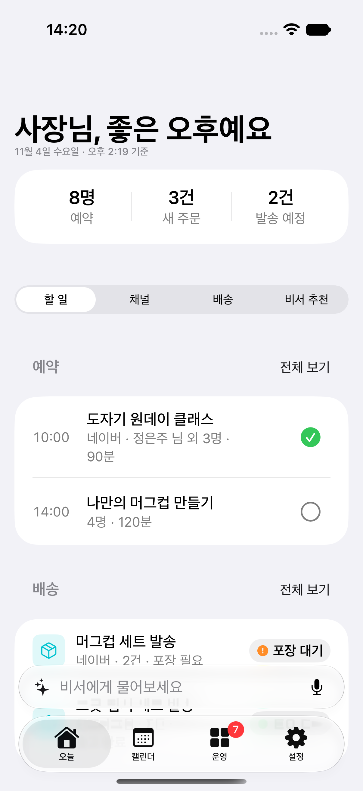
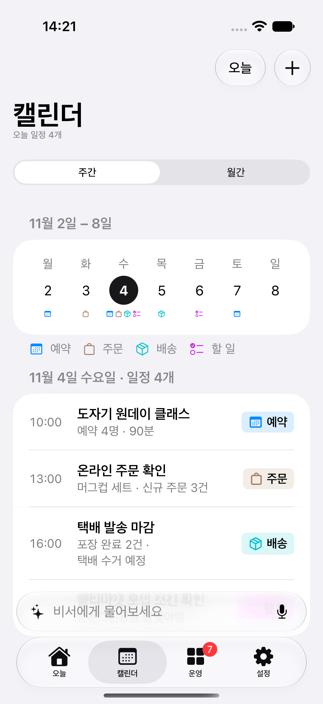
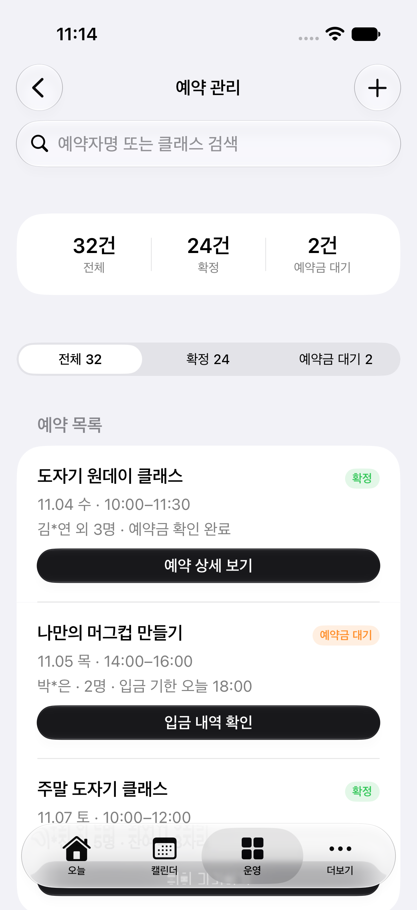
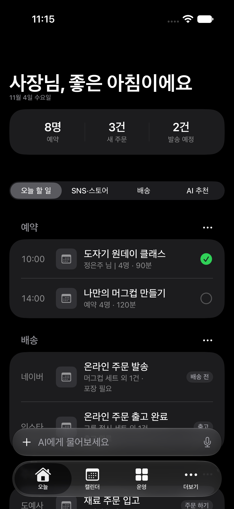
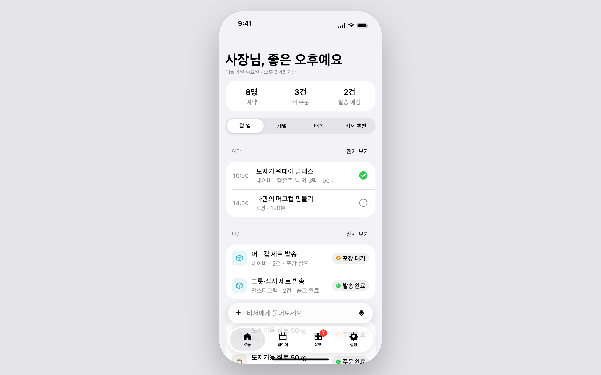

# 공방 AI 비서 iOS 목업

공방 AI 비서 사장님용 대시보드를 SwiftUI로 옮긴 화면 골격입니다. 탭 바와 내비게이션 바, 화면 배치를 [Figma 파일](https://www.figma.com/design/nUn7ayeiKAVljMiPvwQQV3/Untitled)대로 짰습니다. 데이터는 Figma 프레임에서 옮긴 고정 샘플이고 업무 로직, 서버, AI는 아직 붙이지 않았습니다. iOS 앱은 Swift Package나 CocoaPods 같은 외부 의존성을 하나도 쓰지 않습니다.

Xcode 없이 화면만 보려면 [웹 버전으로 보기](#웹-버전으로-보기)로 바로 넘어가면 됩니다. 같은 화면을 브라우저에서 띄웁니다.

## 스크린샷

| 오늘 | 캘린더 (주간) | 운영 | 예약 관리 |
|---|---|---|---|
|  |  |  |  |

| iPad | 다크 모드 |
|---|---|
|  |  |

## 목차

- [화면 구성](#화면-구성)
- [웹 버전으로 보기](#웹-버전으로-보기)
- [준비물](#준비물)
- [시뮬레이터에서 실행하기](#시뮬레이터에서-실행하기)
- [시뮬레이터 사용 팁](#시뮬레이터-사용-팁)
- [실제 iPhone에서 실행하기 (검증하지 않음)](#실제-iphone에서-실행하기-검증하지-않음)
- [테스트 실행하기](#테스트-실행하기)
- [명령줄로 빌드·테스트하기](#명령줄로-빌드테스트하기)
- [문제 해결](#문제-해결)
- [프로젝트 구조](#프로젝트-구조)
- [Figma 화면과 코드 대응표](#figma-화면과-코드-대응표)
- [사용한 iOS 기본 구성 요소](#사용한-ios-기본-구성-요소)
- [아직 넣지 않은 것](#아직-넣지-않은-것)

## 화면 구성

앱 아래쪽 탭은 네 개입니다.

| 탭 | SF Symbol | 내용 |
|---|---|---|
| 오늘 | house | 시간대에 맞춘 인사 제목, 날짜와 마지막 업데이트 시각 부제, 숫자 3개, 할 일 / 채널 / 배송 / 비서 추천 세그먼트, 그룹 목록 |
| 캘린더 | calendar | 주간 보기가 기본이고 한 번 누르면 월간 보기, 선택한 날의 일정 |
| 운영 | square.grid.2x2 | 배지 7, "먼저 확인해주세요", 11월 운영 현황, 전체 업무 관리, 공방 성장 |
| 설정 | gearshape | 공방 정보, 예약·환불 규정, 고객 안내 문구, 채널 연결, 직원·권한, 알림, 계정, 도움말 |

### 오늘

제목 인사말은 시간대에 따라 바뀝니다. 아침에는 "사장님, 좋은 아침이에요"라고 인사합니다. 화면을 아래로 당기면 새로 고침이 일어납니다. 예약 행의 체크 버튼을 누르거나 행을 오른쪽으로 밀면 완료로 바꾸면서 햅틱을 울립니다.

### 비서 막대

"비서에게 물어보세요" 막대는 모든 탭에서 탭 바 위에 붙어 있습니다. 막대를 누르면 비서 시트가 올라옵니다. 시트가 열리면 커서가 바로 입력창에 놓이고 추천 질문 세 개가 보입니다. 입력창 아래에는 "비서가 틀릴 수 있어요"라는 문구를 넣었습니다. 막대의 마이크 버튼은 시트를 음성 모드로 엽니다. 이 모드에서는 키보드의 받아쓰기 키를 쓰라고 안내합니다. 질문에 답하는 기능은 아직 연결하지 않았습니다.

### 캘린더

일정 종류는 색과 기호로 구분합니다.

| 종류 | 색 | SF Symbol |
|---|---|---|
| 예약 | 파랑 | calendar |
| 주문 | 갈색 | bag |
| 배송 | 청록 | shippingbox |
| 할 일 | 보라 | checklist |

일정이 있는 날을 고르면 요약이 나옵니다. 일정이 없는 날에는 "이 날은 일정이 없어요" 문구와 일정 추가하기가 뜹니다.

### 운영

운영 탭 아이콘에는 배지 7이 붙습니다. 맨 위 "먼저 확인해주세요"에는 누를 수 있는 행이 셋 있습니다. 예약금 미확인 2건, 미답변 문의 3건, 발송 마감 2건입니다. 행을 누르면 맞는 관리 화면이 필터를 미리 건 채로 열립니다.

그 아래 11월 운영 현황에는 처리율이라고 적힌 75% 링과 숫자 4개, 전월 대비 수치 한 쌍이 있습니다. 기간 메뉴에서 11월이나 10월을 고르면 고른 쪽에 체크 표시가 붙습니다. 이어서 행 네 개로 된 전체 업무 관리, 기회와 리포트를 담은 공방 성장 순으로 나옵니다.

전체 업무 관리에서는 예약 관리, 주문 관리, 배송 관리, SNS·스토어 관리 화면으로 넘어갑니다. 상태 필터와 검색창은 이제 목록을 실제로 걸러 냅니다. SNS·스토어 관리의 필터는 전체, 채널, 문의, 콘텐츠 네 가지입니다. 맞는 항목이 없을 때는 빈 상태 안내를 띄웁니다. 주문 관리와 배송 관리에는 순서 두 가지를 고르는 정렬 메뉴도 있습니다.

상태 배지는 기호와 글자를 함께 보여 줍니다. 주황은 처리가 필요한 일, 초록은 끝난 일, 회색은 진행 중인 일입니다.

### 설정

설정 항목을 누르면 모두 "준비 중" 화면이 열립니다. 이 탭은 아직 Figma 프레임이 없어서 임시로 만들었습니다.

### 화면 공통

화면마다 채워진(prominent) 버튼은 하나만 둡니다. 무언가를 열기만 하는 카드는 행 전체를 누를 수 있게 했습니다.

iPad에서는 탭이 화면 위쪽 막대로 올라갑니다. 다크 모드에서는 시스템 색을 그대로 씁니다. 글자 크기를 접근성 크기까지 키우면 숫자 줄은 세로로 쌓이고 세그먼트 컨트롤은 메뉴로 바뀝니다.

## 웹 버전으로 보기

Xcode를 열지 않고도 브라우저에서 같은 화면을 보려고 `web/` 폴더에 웹 버전을 만들었습니다. 화면은 React로 다시 짰고 문구와 샘플 데이터는 iOS 앱에서 그대로 가져왔습니다.

앱 화면 전체를 402×871px 세로 창 하나에 고정했습니다. 비율은 19.5:9이고 폭은 iPhone 17과 같은 402px입니다. 브라우저 크기를 바꾸면 창 전체가 같은 비율로 커지거나 작아질 뿐 배치는 그대로입니다. 스크롤도 창 안의 목록에서만 일어납니다.



### 웹 버전 실행하기

[Bun](https://bun.sh)이 필요합니다. macOS와 Bun 1.4.0에서 확인했고 Windows와 Linux에서는 아직 돌려 보지 않았습니다. 저장소를 받은 뒤 최상위 폴더에서 아래 명령을 차례로 실행하면 됩니다.

```bash
cd web
bun install
bun run dev
```

터미널에 `gb-web: http://localhost:3000/`이 찍히면 그 주소를 브라우저로 엽니다. 3000번 포트를 다른 프로그램이 쓰고 있다면 `PORT=4317 bun run dev`처럼 포트 번호를 바꿔 띄웁니다. 서버는 터미널에서 `Ctrl+C`로 끕니다.

### 주소 뒤에 붙이는 옵션

| 옵션 | 화면 |
|---|---|
| `?theme=dark`, `?theme=light` | 시스템 설정과 상관없이 다크 모드나 라이트 모드로 엽니다. 붙이지 않으면 시스템 설정을 따릅니다 |
| `?state=loading` | 회색 자리 표시만 보이는 로딩 화면 |
| `?state=empty` | 데이터가 하나도 없을 때 나오는 빈 화면 |
| `?state=error` | 불러오지 못했을 때 나오는 오류 화면 |

state 옵션은 iOS 앱의 `-screenState` 실행 인자와 같은 일을 합니다. 오늘 탭, 캘린더 탭, 운영 탭 안의 관리 화면 네 개가 이 값을 읽습니다. 두 옵션을 `?theme=dark&state=empty`처럼 함께 붙여도 됩니다.

### 그 밖의 명령

`web/` 폴더에서 실행합니다.

| 명령 | 하는 일 |
|---|---|
| `bun run typecheck` | TypeScript 타입 검사 |
| `bun run build` | 배포용 정적 파일을 `web/dist/`에 묶음 |
| `bun run start` | `--hot` 없이 서버를 띄움 |

### iOS 앱과 다른 점

- 당겨서 새로고침은 없습니다. 비서 시트도 끌어서 크기를 바꾸지 못하고 위쪽 손잡이를 눌러야 커지거나 작아집니다.
- 큰 글자 설정(Dynamic Type)과 iPad 배치는 옮기지 않았습니다.
- 아이콘은 SF Symbols를 본떠 SVG로 직접 그렸기 때문에 모양이 조금 다릅니다.
- 마이크 버튼은 음성 안내 문구가 담긴 비서 시트를 엽니다. 실제 음성 입력은 받지 않습니다.

iOS 앱과 웹 버전은 코드를 공유하지 않습니다. 화면이나 문구를 바꿀 때는 양쪽을 함께 고쳐야 합니다.

## 준비물

직접 확인한 환경은 아래 한 가지뿐입니다.

| 항목 | 확인한 값 |
|---|---|
| Mac | Apple silicon, macOS 27.2 |
| Xcode | 27.2 (build 27B52) |
| 시뮬레이터 | iOS 27.2, iPhone 17과 iPad Pro 11-inch (M5) |

앱의 배포 대상은 iOS 26.1입니다. 그래서 iOS SDK 26.1 이상을 담은 Xcode라면 빌드할 수 있어야 합니다. 다만 실제로 시험한 버전은 Xcode 27.2뿐입니다.

## 시뮬레이터에서 실행하기

Xcode를 처음 여는 분도 아래 순서를 그대로 따라 하면 됩니다.

1. Mac App Store에서 Xcode를 설치합니다. developer.apple.com/download에서 받아도 됩니다.
2. Xcode를 한 번 실행합니다. 추가 구성 요소를 설치하겠느냐고 물으면 설치를 끝까지 진행합니다.
3. iOS 시뮬레이터 런타임이 없다면 메뉴에서 **Xcode > Settings… > Components**를 엽니다. 목록에서 iOS 27.x 시뮬레이터를 내려받습니다.
4. 터미널을 열고 저장소를 받은 뒤 프로젝트를 엽니다.

   ```bash
   git clone https://github.com/stevenahhh/gb-ios.git
   cd gb-ios
   open GongbangAssistant.xcodeproj
   ```

   `gb-ios` 폴더 안에서 아래 명령을 써도 프로젝트가 열립니다.

   ```bash
   xed .
   ```

5. Xcode 창 맨 위 도구 막대를 봅니다. 스킴은 **GongbangAssistant**로 고르고 실행 대상은 **iPhone 17 (iOS 27.2)**로 고릅니다.
6. **⌘R**을 누르거나 도구 막대의 **▶** 버튼을 누릅니다. Simulator가 열리고 앱이 오늘 탭에서 시작합니다.
7. 실행을 멈출 때는 **⌘.**을 누릅니다.

### SwiftUI 미리보기

화면 파일에는 모두 `#Preview`를 넣어 두었습니다. 아무 뷰 파일이나 연 다음 **Editor > Canvas**(⌥⌘↩)를 켜면 시뮬레이터 없이도 화면이 바로 뜹니다.

### 로딩·빈 화면·오류 화면 보기

앱은 실행 인자 `-screenState loading`, `-screenState empty`, `-screenState error`를 받습니다. 각각 로딩 자리 표시, 빈 화면, 다시 시도 버튼이 있는 오류 화면을 보여 줍니다.

1. 메뉴에서 **Product > Scheme > Edit Scheme…**를 엽니다.
2. 왼쪽에서 **Run**을 고르고 **Arguments** 탭으로 갑니다.
3. **Arguments Passed On Launch**에 `-screenState empty`를 추가합니다.
4. **⌘R**로 다시 실행하면 빈 화면이 뜹니다.

명령줄에서는 앱을 설치한 뒤 이렇게 실행합니다.

```bash
xcrun simctl launch booted com.stevenahhh.GongbangAssistant -screenState empty
```

## 시뮬레이터 사용 팁

| 하고 싶은 일 | 방법 |
|---|---|
| 다크 모드 전환 | Features > Toggle Appearance (⇧⌘A) |
| 화면 회전 | ⌘← / ⌘→ |
| 스크린샷 저장 | ⌘S |
| 홈 화면으로 | ⇧⌘H |
| 글자 크기 바꾸기 | Xcode 디버그 막대의 Environment Overrides 버튼(Dynamic Type), 또는 시뮬레이터 안 Settings 앱 > Accessibility > Display & Text Size > Larger Text |
| iPad 화면 보기 | 실행 대상을 "iPad Pro 11-inch (M5)"로 바꾸고 다시 실행 |

## 실제 iPhone에서 실행하기 (검증하지 않음)

> 이 절의 절차는 실제 기기에서 시험하지 않았습니다. 작업하는 동안 쓸 수 있는 iPhone이 없었기 때문입니다. 순서대로 해도 막히는 곳이 있을 수 있습니다.

Apple Account가 있어야 합니다. 무료 Personal Team으로도 앱에 서명할 수 있습니다.

1. **Xcode > Settings… > Accounts**에서 Apple Account를 추가합니다.
2. 프로젝트 내비게이터에서 GongbangAssistant 프로젝트를 고른 뒤 target GongbangAssistant > **Signing & Capabilities**로 갑니다. **Team**에서 본인 팀을 고릅니다.
3. Bundle Identifier `com.stevenahhh.GongbangAssistant`를 겹치지 않는 값으로 바꿉니다. 예를 들어 `com.<yourname>.GongbangAssistant`처럼 씁니다. 기기에서 테스트도 돌릴 생각이면 UI 테스트 타깃의 `com.stevenahhh.GongbangAssistantUITests`도 바꿔 줍니다.
4. iPhone을 케이블로 Mac에 연결하고 iPhone 화면에서 **Trust**를 누릅니다. iPhone은 iOS 26.1 이상이어야 합니다.
5. iPhone에서 개발자 모드를 켭니다. Settings > Privacy & Security > Developer Mode를 켜고 재시동한 뒤 확인을 누릅니다.
6. Xcode 실행 대상을 연결한 iPhone으로 바꾸고 **⌘R**을 누릅니다.
7. 무료 계정이면 첫 실행이 신뢰하지 않은 개발자라는 이유로 막힐 수 있습니다. 그때는 iPhone의 Settings > General > VPN & Device Management에서 개발자 인증서를 신뢰로 바꿉니다.

## 테스트 실행하기

Xcode에서 **Product > Test**(⌘U)를 누르면 GongbangAssistantUITests가 돕니다.

| 테스트 클래스 | 테스트 | 확인하는 내용 |
|---|---|---|
| TabNavigationUITests | testEveryTabShowsItsNavigationTitle | 탭을 모두 눌러 각 탭의 제목을 확인 |
| TabNavigationUITests | testOperationsPushesAreaScreenAndGoesBack | 운영 > 예약 관리로 들어갔다가 돌아오기 |
| TabNavigationUITests | testStatusFilterAndSearchNarrowTheList | 배송 관리에서 완료 필터와 검색어가 목록을 실제로 줄이는지 |
| TabNavigationUITests | testAssistantIsReachableFromEveryTab | 캘린더 탭에서도 AI 막대와 마이크가 보이고 비서 시트를 여는지 |
| ScreenshotTourUITests | testCaptureEveryScreen | 모든 화면과 스크롤 끝, 완료 필터 화면, 검색 결과가 없는 화면을 찍어 테스트 첨부물로 저장 |
| ScreenshotTourUITests | testCaptureScreenStates | 오늘, 캘린더, 예약 관리의 로딩·빈 화면·오류 화면을 찍어 저장 |

결과는 Test navigator(⌘6)에 뜹니다. 스크린샷은 Report navigator(⌘9)에서 해당 실행 아래에 있습니다.

## 명령줄로 빌드·테스트하기

아래 명령은 [준비물](#준비물)의 환경에서 실행해 봤습니다. `sudo xcode-select` 한 줄만 예외입니다. 저장소 최상위 폴더에서 실행합니다.

먼저 Xcode 버전을 확인합니다.

```bash
xcodebuild -version
```

여기서 다음 오류가 나면 명령줄 도구가 Xcode 대신 Command Line Tools를 가리키는 것입니다.

```
xcode-select: error: tool 'xcodebuild' requires Xcode, but active developer directory '/Library/Developer/CommandLineTools' is a command line tools instance
```

아래 명령을 한 번 실행해 Xcode로 바꿉니다.

```bash
sudo xcode-select -s /Applications/Xcode.app/Contents/Developer
```

이 명령은 관리자 암호를 묻기 때문에 작업 중에는 실행하지 않았습니다. 시스템 설정을 건드리기 싫다면 명령마다 앞에 `DEVELOPER_DIR=/Applications/Xcode.app/Contents/Developer`를 붙여도 됩니다. 이 문서의 다른 명령은 모두 이 접두어를 붙여 확인했습니다.

스킴 목록과 쓸 수 있는 시뮬레이터를 확인합니다.

```bash
xcodebuild -list -project GongbangAssistant.xcodeproj
xcrun simctl list devices available
```

다음 명령으로 빌드합니다.

```bash
xcodebuild -project GongbangAssistant.xcodeproj -scheme GongbangAssistant -destination 'platform=iOS Simulator,name=iPhone 17,OS=27.2' -derivedDataPath build/DerivedData build
```

빌드가 끝나면 앱을 시뮬레이터에 설치해 실행해 봅니다.

```bash
xcrun simctl boot "iPhone 17"
open -a Simulator
xcrun simctl install booted build/DerivedData/Build/Products/Debug-iphonesimulator/GongbangAssistant.app
xcrun simctl launch booted com.stevenahhh.GongbangAssistant
```

테스트를 돌려 결과 번들을 만들고 스크린샷을 꺼냅니다.

```bash
xcodebuild test -project GongbangAssistant.xcodeproj -scheme GongbangAssistant -destination 'platform=iOS Simulator,name=iPhone 17,OS=27.2' -derivedDataPath build/DerivedData -resultBundlePath build/TestResults.xcresult
xcrun xcresulttool export attachments --path build/TestResults.xcresult --output-path build/screenshots
```

런타임이 여러 개 깔려 있으면 같은 이름의 기기가 둘 이상 생깁니다. 이럴 때는 위처럼 `OS=27.2`를 붙이거나 `simctl list`에서 찾은 `id=<UDID>`를 씁니다. `build/` 폴더는 `.gitignore`에 들어 있어 커밋에 섞이지 않습니다.

## 문제 해결

| 증상 | 원인 | 해결 |
|---|---|---|
| "Unable to find a destination matching the provided destination specifier" | 그 시뮬레이터나 런타임이 설치돼 있지 않음 | `xcrun simctl list devices available`로 확인한 뒤 Settings > Components에서 런타임을 설치하거나 다른 기기 이름을 고릅니다 |
| "Signing for "GongbangAssistant" requires a development team" | 실제 기기로 빌드할 때만 생김 | [실제 iPhone](#실제-iphone에서-실행하기-검증하지-않음) 절의 2단계대로 Team을 지정합니다 |
| Xcode 버전을 바꾼 뒤 이상한 빌드 오류 | 이전 빌드 산출물이 남아 있음 | Product > Clean Build Folder(⇧⌘K)를 누르거나 `~/Library/Developer/Xcode/DerivedData/GongbangAssistant-*`를 지웁니다 |
| VS Code나 Cursor에 "No such module 'UIKit'" 또는 "No such module 'XCTest'" | 편집기의 Swift 언어 서버가 Command Line Tools를 씀 | Xcode나 xcodebuild로 빌드합니다 |
| `xcrun simctl boot`에서 "Unable to boot device in current state: Booted" | 그 시뮬레이터가 이미 켜져 있음 | 오류가 아니므로 다음 명령으로 넘어갑니다 |
| `open -a Simulator`에서 "Unable to find application named 'Simulator'" | 이 Mac에 Simulator 앱이 없음. 확인한 Mac도 이 경우였음 | 시뮬레이터는 화면 없이 돌아가므로 install과 launch는 그대로 됩니다. 화면은 `xcrun simctl io booted screenshot screen.png`로 저장해 확인합니다 |
| `install booted`나 `launch booted`가 엉뚱한 기기에 들어감 | 시뮬레이터를 두 대 이상 켜 둠 | `booted` 대신 `xcrun simctl list devices booted`에서 찾은 UDID를 씁니다 |
| 기기 언어를 바꿔도 화면이 한국어 | 원래 그렇게 만듦. 달력 로케일은 ko_KR로 고정 | 고칠 것 없음 |

## 프로젝트 구조

```
GongbangAssistant.xcodeproj        프로젝트, 공유 스킴
GongbangAssistant/
├── GongbangAssistantApp.swift     앱 진입점
├── RootTabView.swift              탭 바, AI 막대, 시트
├── Today/TodayView.swift
├── Calendar/
│   ├── CalendarScreen.swift
│   └── MonthCalendarView.swift    UICalendarView 래퍼
├── Operations/
│   ├── OperationsView.swift
│   └── OperationAreaView.swift
├── Settings/SettingsView.swift
├── Assistant/AssistantViews.swift AI 막대와 비서 시트
├── Shared/
│   ├── Components.swift           숫자 줄, 행, 카드, 배지
│   └── SampleData.swift           샘플 데이터
└── Assets.xcassets                AccentColor, AppIcon (라이트, 다크, 틴트)
GongbangAssistantUITests/
├── TabNavigationUITests.swift
└── ScreenshotTourUITests.swift
web/                               브라우저용 웹 버전 (Bun, React)
├── index.html                     진입 HTML
├── server.ts                      개발 서버
├── package.json, bun.lock
└── src/
    ├── main.tsx                   폰 창 크기 맞춤, 탭과 화면 이동
    ├── screens.tsx                탭별 화면과 비서 시트
    ├── ui.tsx                     카드, 행, 배지 같은 공통 요소
    ├── data.ts                    iOS 앱과 같은 샘플 데이터
    ├── icons.tsx                  SF Symbols를 본떠 그린 SVG 아이콘
    └── styles.css                 iOS 시스템 색과 다크 모드
docs/screenshots/                  README 이미지
DESIGN.md                          화면별 목표와 배치 원칙
```

## Figma 화면과 코드 대응표

| Figma 프레임 | 노드 | 코드 |
|---|---|---|
| 메인화면-오늘할 일 / SNS 스토어 / 배송 / AI 추천 | 1005:34, 1005:107, 1007:92, 1053:241, 1007:128 | `Today/TodayView.swift` |
| 캘린더-월간 / 주간 | 1013:68, 1013:182 | `Calendar/` |
| 운영-전체 현황 | 1054:394 | `Operations/OperationsView.swift` |
| 운영-예약/주문/배송/SNS·스토어 관리 | 1016:331, 1016:570, 1016:809, 1016:1048 | `Operations/OperationAreaView.swift` |
| 하단 메뉴 + AI Chat Input | | `RootTabView.swift`, `Assistant/AssistantViews.swift` |
| 설정 | 프레임 없음 | `Settings/SettingsView.swift` |

## 사용한 iOS 기본 구성 요소

화면은 직접 그린 컴포넌트 대신 시스템 기본 요소로 짰습니다.

- `TabView`와 `Tab`, `.tabViewStyle(.sidebarAdaptable)`, `.tabBarMinimizeBehavior(.onScrollDown)`, `.tabViewBottomAccessory`
- 탭마다 `NavigationStack`을 두고 `navigationTitle`과 `navigationSubtitle`을 씀
- `UICalendarView`, `Gauge`, `.searchable`, `ContentUnavailableView`
- `.refreshable`, `.badge`, `.sensoryFeedback`
- `@SceneStorage`로 마지막 탭과 오늘 세그먼트, 캘린더 보기 방식을 기억함
- SF Symbols, 시스템 색, Dynamic Type 글꼴 스타일

카드 안에서는 주된 동작 하나에만 `.borderedProminent`를 쓰고 나머지 버튼은 `.bordered`로 그립니다. 글라스 효과는 탭 바와 도구 막대, AI 막대, 비서 입력창에만 남겼습니다. 동작 줄이기를 켜 두면 스크롤해도 탭 바가 줄어들지 않습니다.

AccentColor는 라이트 모드에서 #18181B, 다크 모드에서 #FAFAFA입니다. Figma의 검은 버튼 색에 맞춘 값입니다. 고대비 모드용으로 #000000과 #FFFFFF도 따로 넣었습니다.

## 아직 넣지 않은 것

- 업무 로직
- 데이터 저장
- 서버 호출과 AI 호출
- 설정의 상세 화면
- 승인·문의 탭
- 앱 전체 검색
- 75%와 전월 대비 두 수치의 정의. Figma에도 정의가 없습니다
